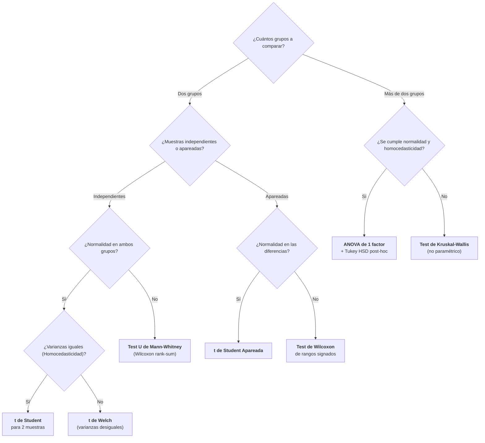

# Sesión 2: Inferencia Estadística, Distribuciones de Probabilidad y Decisión Bajo Incertidumbre
## De los Contrastes de Hipótesis al A/B Testing Industrial y Causal AI

> **Materia**: Inferencia Estadística Paramétrica y No Paramétrica  
> **Programa**: Máster Universitario en Big Data & Data Science (MUBD) — LaSalle Campus Barcelona  
> **Conexión Tecnológica**: Plataformas de Experimentación Online a Gran Escala (A/B Testing), Técnicas de Reducción de Varianza (CUPED), Multi-Armed Bandits (Thompson Sampling), Control de Falso Descubrimiento (FDR en Big Data), y Validación Estadística de Arquitecturas de Machine Learning.

---

## 1. Fundamentos Teóricos de la Sesión 2

### 1.1. El Teorema del Límite Central (TLC) y Distribuciones Muestrales
El Teorema del Límite Central es el puente matemático que permite hacer inferencias sobre poblaciones desconocidas a partir de muestras finitas. 

**Formulación Matemática**:  
Sean $X_1, X_2, \dots, X_n$ variables aleatorias independientes e idénticamente distribuidas (i.i.d.) procedentes de cualquier distribución poblacional con media finita $\mu$ y varianza finita $\sigma^2 > 0$. La media muestral es $\bar{X}_n = \frac{1}{n} \sum_{i=1}^n X_i$. A medida que el tamaño muestral $n \to \infty$:
$$\sqrt{n}\left( \frac{\bar{X}_n - \mu}{\sigma} \right) \xrightarrow{d} \mathcal{N}(0, 1)$$
Lo que equivale a decir que la distribución muestral de la media se aproxima a una distribución normal:
$$\bar{X}_n \sim \mathcal{N}\left( \mu, \; \frac{\sigma^2}{n} \right)$$
El error estándar de la media es $\mathrm{SE}(\bar{X}) = \frac{\sigma}{\sqrt{n}}$. Nótese que para reducir el error estándar a la mitad se requiere cuadruplicar el tamaño muestral ($4n$).

---

### 1.2. Las Cuatro Distribuciones Fundamentales de la Inferencia
1. **Distribución Normal $\mathcal{N}(\mu, \sigma^2)$**: Modelo de referencia universal por acción del TLC.
2. **Distribución $t$ de Student ($t_\nu$)**:
   - Surge cuando la varianza poblacional $\sigma^2$ es desconocida y se reemplaza por la varianza muestral $s^2$:
     $$t = \frac{\bar{X} - \mu}{s / \sqrt{n}} \sim t_{n-1}$$
   - Sus colas son más pesadas que las de la normal para modelar la incertidumbre adicional introducida por estimar $\sigma$ mediante $s$. Cuando los grados de libertad $\nu = n - 1 \to \infty$, la distribución $t$ converge a la Normal estándar $\mathcal{N}(0, 1)$.
3. **Distribución Chi-Cuadrado ($\chi^2_k$)**:
   - Es la distribución de la suma de los cuadrados de $k$ variables normales estándar independientes:
     $$\chi^2 = \sum_{i=1}^k Z_i^2, \quad \text{donde } Z_i \sim \mathcal{N}(0, 1)$$
   - Propiedades: Asimétrica positiva, definida en $[0, \infty)$, con media $k$ y varianza $2k$. Sustenta la estimación de varianzas, el test de bondad de ajuste, el test de independencia en tablas de contingencia y el test de Hosmer-Lemeshow.
4. **Distribución $F$ de Snedecor-Fisher ($F_{d_1, d_2}$)**:
   - Es el cociente de dos variables $\chi^2$ independientes divididas por sus respectivos grados de libertad:
     $$F = \frac{\chi^2_{d_1} / d_1}{\chi^2_{d_2} / d_2}$$
   - Sustenta el contraste de igualdad de varianzas, el Análisis de Varianza (ANOVA) y el contraste global de significación en regresión múltiple.

---

### 1.3. Estimación por Intervalos de Confianza (IC)

#### A. Intervalo para la Media con Varianza Desconocida
$$\mathrm{IC}_{1-\alpha}(\mu) = \left[ \bar{x} - t_{\alpha/2, n-1} \frac{s}{\sqrt{n}}, \; \bar{x} + t_{\alpha/2, n-1} \frac{s}{\sqrt{n}} \right]$$

#### B. Intervalos de Confianza para Proporciones
- **Aproximación de Wald (Asintótica Normal)**: $\hat{p} \pm z_{\alpha/2} \sqrt{\frac{\hat{p}(1-\hat{p})}{n}}$.
  * *Inconveniente grave*: Falla catastróficamente cuando $p$ se acerca a 0 o 1 o cuando $n$ es moderado. Puede arrojar límites absurdos fuera del rango $[0, 1]$ y su cobertura real es con frecuencia muy inferior al $95\%$ nominal.
- **Intervalo de Wilson (Score Interval)**: Invierte el contraste de score de la binomial:
  $$\mathrm{IC}_{\text{Wilson}} = \frac{\hat{p} + \frac{z^2}{2n} \pm z \sqrt{\frac{\hat{p}(1-\hat{p})}{n} + \frac{z^2}{4n^2}}}{1 + \frac{z^2}{n}}$$
  Garantiza límites estrictamente dentro de $[0, 1]$ y coberturas empíricas extremadamente fiables. Es el estándar recomendado para métricas de conversión o clic en analítica digital.
- **Intervalo Exacto de Clopper-Pearson**: Basado en los cuantiles de la distribución Beta/Binomial; garantiza una cobertura mínima del $1-\alpha$, aunque resulta conservador (intervalo más ancho).

#### C. Remuestreo Bootstrap No Paramétrico
Cuando no se pueden asumir distribuciones teóricas conocidas (e.g., estimar el intervalo de confianza de una mediana, de una relación de varianzas o del AUC de un modelo):
1. Se extraen $B$ remuestreos aleatorios con reemplazo ($B \ge 2.000$) del mismo tamaño $n$ que la muestra original.
2. Se calcula el estadístico de interés $\hat{\theta}^*_b$ en cada réplica.
3. El **Intervalo Percentil** toma directamente los cuantiles $\alpha/2$ y $1 - \alpha/2$ de la distribución empírica de réplicas bootstrap.
4. El **Intervalo BCa (*Bias-Corrected and Accelerated*)** ajusta adicionalmente el sesgo de la mediana y la aceleración (asimetría), alcanzando precisión de segundo orden $O(1/n)$.

---

### 1.4. Marco de Contraste de Hipótesis de Neyman-Pearson

#### A. Definición Formal del p-valor
En un contraste donde se formula una hipótesis nula $H_0$ (ausencia de efecto o diferencia) frente a una alternativa $H_1$, el **p-valor** se define como:
$$p\text{-valor} = P(T(\mathbf{X}) \ge t_{\text{obs}} \mid H_0 \text{ es estrictamente cierta})$$
Es una medida de discrepancia condicional: cuantifica lo inusuales que serían los datos observados si el mundo funcionara según el modelo nulo.

> [!CAUTION]
> **Desmitificación de Falacias Frecuentes sobre el p-valor**:
> 1. El p-valor **NO** es $P(H_0 \mid \text{Datos})$. La probabilidad de la hipótesis solo existe en el marco de la inferencia bayesiana mediante el teorema de Bayes: $P(H_0 \mid D) \propto P(D \mid H_0) P(H_0)$.
> 2. El p-valor **NO** mide el tamaño del efecto ni su relevancia práctica. Con muestras masivas ($n > 10^6$), variaciones irrelevantes del 0.001% alcanzan $p < 10^{-10}$.
> 3. Un p-valor alto ($p > 0{,}05$) **NO** demuestra que $H_0$ sea verdadera; simplemente indica que los datos son compatibles con $H_0$ dada la potencia del test.

#### B. Errores de Decisión, Nivel de Significación y Potencia
- **Nivel de Significación ($\alpha$)**: Máxima probabilidad tolerada de cometer un **Error Tipo I** (rechazar $H_0$ siendo verdadera / Falso Positivo). Típicamente $\alpha = 0{,}05$.
- **Error Tipo II ($\beta$)**: Probabilidad de no rechazar $H_0$ siendo falsa (Falso Negativo).
- **Potencia Estadística ($1 - \beta$)**: Probabilidad de detectar un efecto real cuando existe:
  $$\text{Potencia} = P(\text{Rechazar } H_0 \mid H_1 \text{ es verdadera})$$
  El estándar industrial exige una potencia mínima del **$80\%$** ($1 - \beta = 0{,}80$) o **$90\%$**.
- **Tamaño del Efecto ($d$ de Cohen)**: Cuantifica la magnitud de la diferencia estandarizada entre dos medias:
  $$d = \frac{\mu_1 - \mu_2}{\sigma_{\text{pooled}}}$$
  Valores de referencia: $d = 0{,}2$ (pequeño), $d = 0{,}5$ (medio), $d = 0{,}8$ (grande). El dimensionamiento de muestra previo (*a priori power analysis*) exige definir el mínimo efecto detectable (*MDE: Minimum Detectable Effect*) para calcular el tamaño muestral necesario antes de iniciar un experimento.

---

### 1.5. Batería Completa de Contrastes Estadísticos



1. **Comparación de Dos Medias**:
   - **t de Student**: Asume normalidad y homogeneidad de varianzas ($\sigma_1^2 = \sigma_2^2$).
   - **t de Welch**: Modifica los grados de libertad mediante la fórmula de Welch-Satterthwaite:
     $$\nu \approx \frac{\left( \frac{s_1^2}{n_1} + \frac{s_2^2}{n_2} \right)^2}{\frac{(s_1^2 / n_1)^2}{n_1 - 1} + \frac{(s_2^2 / n_2)^2}{n_2 - 1}}$$
     Es robusto ante varianzas desiguales y desbalanceo en el tamaño de los grupos ($n_1 \neq n_2$). **Debe ser la opción predeterminada en análisis de datos modernos**.
   - **Test U de Mann-Whitney**: Alternativa no paramétrica basada en rangos; compara las funciones de distribución acumulada cuando la normalidad es violada.
2. **Comparación de Muestras Apareadas**:
   - **t Apareada**: Evalúa si la media de las diferencias individuales $D_i = X_{1i} - X_{2i}$ difiere de cero: $t = \frac{\bar{D}}{s_D / \sqrt{n}}$. Elimina la variabilidad entre sujetos.
   - **Test de Wilcoxon de Rangos Signados**: Alternativa no paramétrica para diferencias continuas asimétricas o de escala ordinal.
3. **Comparación de Más de Dos Grupos (ANOVA)**:
   - Descomposición de la varianza: $\mathrm{SS}_{\text{total}} = \mathrm{SS}_{\text{between}} + \mathrm{SS}_{\text{within}}$.
   - Estadístico $F = \frac{\mathrm{MS}_{\text{between}}}{\mathrm{MS}_{\text{within}}} \sim F_{k-1, N-k}$.
   - Pruebas post-hoc: Si se rechaza la igualdad global de medias, el test de **Tukey HSD (*Honestly Significant Difference*)** compara todas las parejas de grupos controlando estrictamente la tasa de error por familia (FWER).
   - Alternativa no paramétrica: **Kruskal-Wallis** ($H \sim \chi^2_{k-1}$).
4. **Variables Categóricas**:
   - **Test $\chi^2$ de Independencia de Pearson**: $\chi^2 = \sum \frac{(O_{ij} - E_{ij})^2}{E_{ij}} \sim \chi^2_{(r-1)(c-1)}$.
   - **Test Exacto de Fisher**: Obligatorio cuando hay frecuencias esperadas $E_{ij} < 5$ en tablas $2 \times 2$.

---

## 2. Aplicación Directa a Big Data e Inteligencia Artificial

### 2.1. A/B Testing Industrial a Gran Escala y Técnicas de Reducción de Varianza (CUPED)
En empresas tecnológicas líderes (Netflix, Uber, Google, Amazon, Spotify), las decisiones de algoritmos y despliegue de modelos se validan mediante experimentación online (A/B testing):
- **Problema de Negocio**: Evaluar si un nuevo algoritmo de recomendación de deep learning incrementa el *tiempo de reproducción* o la *tasa de conversión*. Si la mejora real es pequeña (e.g., $+0{,}8\%$), se necesitan millones de usuarios y varias semanas de test para alcanzar significación estadística.
- **La Solución Matemática: CUPED (Controlled-experiment Using Pre-Experiment Data)**:
  Diseñado por Deng et al. (Microsoft, 2013), aprovecha los datos de comportamiento previo del usuario ($X$) registrados antes de que comenzara el experimento:
  $$Y_{\text{CUPED}, i} = Y_i - \theta \left( X_i - E[X] \right), \quad \text{donde } \theta = \frac{\mathrm{Cov}(Y, X)}{\mathrm{Var}(X)}$$
  La varianza de la nueva variable transformada es:
  $$\mathrm{Var}(Y_{\text{CUPED}}) = \mathrm{Var}(Y) \cdot \left( 1 - \rho_{XY}^2 \right)$$
  Donde $\rho_{XY}$ es la correlación entre la métrica durante el test y la métrica previa del usuario.
  * *Impacto en Big Data*: Con una correlación histórica habitual de $\rho \approx 0{,}7$, la varianza de la métrica se reduce en un **$50\%$**. Esto equivale exactamente a **duplicar el tamaño de la muestra de forma gratuita**, permitiendo finalizar los experimentos en la mitad de tiempo o detectar efectos dos veces más pequeños con la misma potencia.

---

### 2.2. Multi-Armed Bandits (MAB): Exploración Adaptativa vs. A/B Testing
El A/B test clásico tiene un alto *coste de oportunidad*: continúa asignando un 50% de los usuarios a una variante perdedora hasta que se alcanza el tamaño de muestra planificado. Los algoritmos de Bandits adaptan el tráfico dinámicamente en tiempo real:

1. **Thompson Sampling (Bayesian Bandits)**:
   - Para cada variante $k$, modela la probabilidad de éxito mediante una distribución a priori $\mathrm{Beta}(\alpha_k, \beta_k)$.
   - Cada vez que un usuario llega, muestrea $\theta_k \sim \mathrm{Beta}(\alpha_k, \beta_k)$ para cada variante y asigna al usuario a la variante con el mayor $\theta_k$.
   - Al observar el resultado (conversión o no), actualiza los hiperparámetros bayesianos en tiempo real: $\alpha_k \leftarrow \alpha_k + y$, $\beta_k \leftarrow \beta_k + (1 - y)$.
   - *Ventaja*: Transfiere tráfico automáticamente a la mejor variante minimizando el *regret acumulado* sin necesidad de contrastes estáticos prefijados.
2. **Upper Confidence Bound (UCB1)**:
   - Aplica el principio de *optimismo ante la incertidumbre*: escoge la variante que maximiza el límite superior del intervalo de confianza:
     $$k^* = \arg\max_k \left( \bar{x}_k + \sqrt{\frac{2 \ln N}{n_k}} \right)$$

---

### 2.3. El Problema de las Comparaciones Múltiples en Big Data: FWER vs. FDR
Cuando un data warehouse o pipeline de analítica evalúa simultáneamente $m = 10.000$ métricas o correlaciones al nivel $\alpha = 0{,}05$, la probabilidad de cometer al menos un Falso Positivo (*Family-Wise Error Rate*) es:
$$\mathrm{FWER} = 1 - (1 - \alpha)^m = 1 - (0{,}95)^{10.000} \approx 1{,}00 \quad (100\%)$$
Aparecerán aproximadamente **$500$ descubrimientos falsos** por puro ruido estocástico.

1. **Control de FWER — Corrección de Bonferroni**:
   Exige que cada p-valor individual cumpla $p_i \le \frac{\alpha}{m} = \frac{0{,}05}{10.000} = 0{,}000005$.
   * *Inconveniente en Big Data*: Es hiperconservador. Destruye la potencia estadística, provocando tasas masivas de Falsos Negativos (deja escapar innovaciones reales).
2. **Control de FDR (False Discovery Rate) — Benjamini-Hochberg (BH)**:
   En lugar de exigir que no exista ni un solo falso positivo, controla la **proporción esperada de falsos positivos entre el total de hipótesis rechazadas**:
   $$\mathrm{FDR} = E\left[ \frac{V}{R} \right] \le q \quad (\text{típicamente } q = 0{,}10 \text{ o } 0{,}05)$$
   *Procedimiento Algorítmico*:
   1. Ordenar los $m$ p-valores de menor a mayor: $p_{(1)} \le p_{(2)} \le \dots \le p_{(m)}$.
   2. Encontrar el mayor índice $k$ tal que:
      $$p_{(k)} \le \frac{k}{m} q$$
   3. Rechazar todas las hipótesis nulas $H_{(1)}, \dots, H_{(k)}$.
   *Es el estándar riguroso e indiscutible en bioinformática, genómica, análisis de registros de clics y data mining masivo*.

---

### 2.4. Validación Estadística de Modelos de Machine Learning y Deep Learning
Comparar dos modelos de clasificación basándose exclusivamente en su exactitud en test (e.g., Modelo A 93.4% vs Modelo B 92.8%) carece de validez científica si no se contrasta formalmente su significación:

1. **Test de McNemar (para Comparación de Clasificadores Apareados)**:
   Construye la matriz de contingencia de aciertos y errores sobre el mismo conjunto de test:
   ```
                            Modelo B Acierta      Modelo B Falla
     Modelo A Acierta             n_00                 n_01
     Modelo A Falla               n_10                 n_11
   ```
   Bajo $H_0$, ambos modelos tienen la misma tasa de error ($P(n_{01}) = P(n_{10})$). El estadístico de contraste es:
   $$\chi^2 = \frac{(|n_{01} - n_{10}| - 1)^2}{n_{01} + n_{10}} \sim \chi^2_1$$
   Permite certificar si las discrepancias entre predicciones se deben al azar o a una superioridad real de una arquitectura neuronal.
2. **$5 \times 2$ Cross-Validated Paired $t$-Test (Dietterich, 1998)**:
   El $k$-fold cross-validation estándar viola el supuesto de independencia del $t$-test (los datos de entrenamiento se solapan en los folds, inflando la tasa de falsos positivos hasta un 40%). El protocolo $5 \times 2$ ejecuta 5 repeticiones de validación cruzada de 2 folds, computando las diferencias entre clasificadores con una varianza estimada que preserva exactamente la tasa nominal del error Tipo I.
