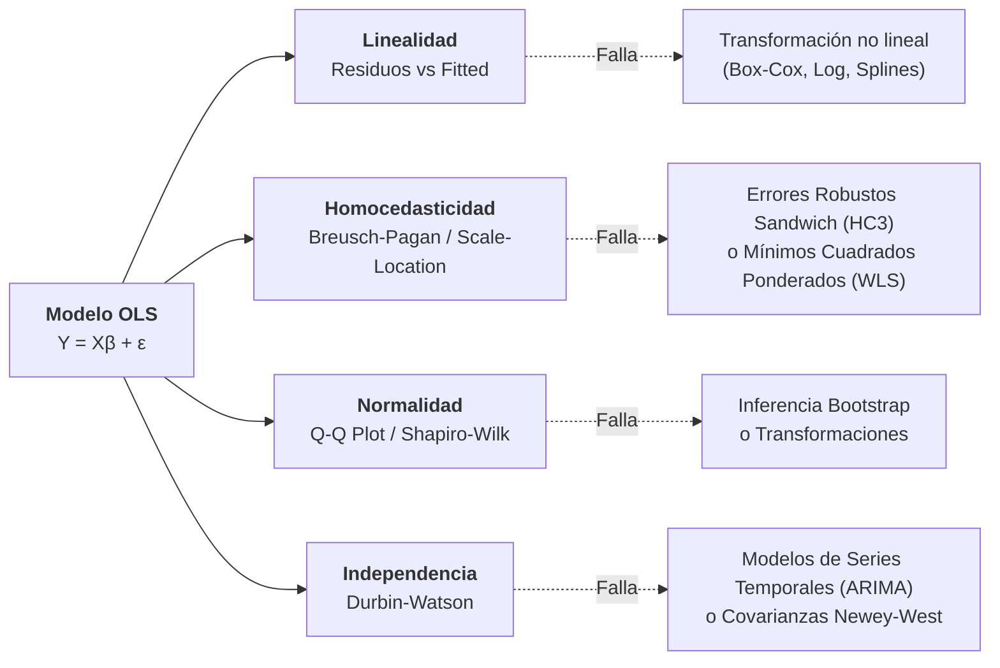

# Sesión 3: El Modelo Lineal General (Regresión Lineal Múltiple) y Diagnósticos
## De los Supuestos de Gauss-Markov a Deep Learning, Regularización (Ridge/Lasso) y XAI

> **Materia**: Modelo Lineal Múltiple (OLS), Diagnóstico de Residuos, Multicolinealidad y Criterios de Información  
> **Programa**: Máster Universitario en Big Data & Data Science (MUBD) — LaSalle Campus Barcelona  
> **Conexión Tecnológica**: Capas Densas en Redes Neuronales, Regularización en Alta Dimensión ($L_1 / L_2$), Optimización Estocástica (Mini-Batch SGD / Adam en Big Data), e Inteligencia Artificial Explicable (XAI / LIME).

---

## 1. Fundamentos Teóricos de la Sesión 3

### 1.1. Formulación Matricial del Modelo Lineal y Estimador OLS
El modelo de regresión lineal múltiple formaliza la relación entre una variable dependiente cuantitativa continua $Y \in \mathbb{R}^n$ y un conjunto de $p$ variables independientes explicativas $X \in \mathbb{R}^{n \times (p+1)}$:
$$Y = X\beta + \varepsilon$$
Donde:
$$Y = \begin{pmatrix} y_1 \\ y_2 \\ \vdots \\ y_n \end{pmatrix}, \quad 
X = \begin{pmatrix} 1 & x_{11} & \dots & x_{1p} \\ 1 & x_{21} & \dots & x_{2p} \\ \vdots & \vdots & \ddots & \vdots \\ 1 & x_{n1} & \dots & x_{np} \end{pmatrix}, \quad 
\beta = \begin{pmatrix} \beta_0 \\ \beta_1 \\ \vdots \\ \beta_p \end{pmatrix}, \quad 
\varepsilon = \begin{pmatrix} \varepsilon_1 \\ \varepsilon_2 \\ \vdots \\ \varepsilon_n \end{pmatrix}$$

El método de **Mínimos Cuadrados Ordinarios (OLS)** busca el vector de coeficientes $\hat{\beta}$ que minimiza la suma de los residuos al cuadrado $S(\beta) = \varepsilon^T \varepsilon$:
$$S(\beta) = (Y - X\beta)^T (Y - X\beta) = Y^T Y - 2\beta^T X^T Y + \beta^T X^T X \beta$$
Derivando respecto a $\beta$ e igualando al vector nulo:
$$\frac{\partial S}{\partial \beta} = -2 X^T Y + 2 X^T X \beta = 0 \implies X^T X \hat{\beta} = X^T Y$$
Si la matriz de Gram $X^T X$ es de rango completo (no singular), se obtiene la **solución cerrada analítica de OLS**:
$$\hat{\beta} = (X^T X)^{-1} X^T Y$$

#### La Matriz de Proyección (*Hat Matrix*)
Los valores ajustados por el modelo son:
$$\hat{Y} = X \hat{\beta} = X (X^T X)^{-1} X^T Y = H Y$$
Donde $H = X(X^T X)^{-1} X^T$ es la **matriz Hat** (sombrero). Sus propiedades matemáticas fundamentales son:
- **Simetría**: $H^T = H$.
- **Idempotencia**: $H^2 = H$. Proyecta ortogonalmente el vector de datos $Y$ sobre el subespacio vectorial generado por las columnas de $X$.
- **Traza**: $\mathrm{tr}(H) = \sum_{i=1}^n h_{ii} = p + 1$ (el número de parámetros estimados en el modelo).

---

### 1.2. El Teorema de Gauss-Markov y las Propiedades BLUE
Bajo los supuestos clásicos de Gauss-Markov:
1. **Linealidad en los parámetros**: $Y = X\beta + \varepsilon$.
2. **Exogeneidad estricta**: $E[\varepsilon \mid X] = 0$.
3. **Homocedasticidad**: $\mathrm{Var}(\varepsilon_i \mid X) = \sigma^2$ (varianza constante para todas las observaciones).
4. **No autocorrelación**: $\mathrm{Cov}(\varepsilon_i, \varepsilon_j \mid X) = 0$ para todo $i \neq j$.
5. **Rango completo de $X$**: $\mathrm{rango}(X) = p + 1 < n$ (ausencia de colinealidad exacta).

**Enunciado del Teorema de Gauss-Markov**:  
El estimador OLS $\hat{\beta}$ es el **BLUE (Best Linear Unbiased Estimator)**: entre todos los estimadores lineales en $Y$ que son insesgados ($E[\hat{\beta}] = \beta$), $\hat{\beta}$ es el que tiene la **menor matriz de varianzas-covarianzas**:
$$\mathrm{Var}(\hat{\beta}) = \sigma^2 (X^T X)^{-1}$$
Si adicionalmente se cumple el supuesto de **normalidad** ($\varepsilon \sim \mathcal{N}(0, \sigma^2 I_n)$), $\hat{\beta}$ coincide con el estimador de Máxima Verosimilitud (MLE) y alcanza la cota inferior de Cramér-Rao (es de varianza mínima absoluta entre todos los estimadores insesgados, lineales o no).

---

### 1.3. Coeficientes Marginales Condicionales y Descomposición de Varianza
- **Interpretación Rigurosa de $\beta_j$**:
  $$\beta_j = \frac{\partial E[Y \mid X]}{\partial X_j}$$
  Representa el cambio promedio esperado en la variable respuesta $Y$ cuando el predictor $X_j$ se incrementa en una unidad, **manteniendo constantes (*ceteris paribus*) todas las demás variables incluidas en el modelo**. No debe confundirse con una correlación simple: el coeficiente refleja el efecto neto incremental de $X_j$ después de descontar el solapamiento lineal con las demás variables.
- **Descomposición de la Suma de Cuadrados**:
  $$\mathrm{SS}_{\text{tot}} = \mathrm{SS}_{\text{reg}} + \mathrm{SS}_{\text{res}} \iff \sum (y_i - \bar{y})^2 = \sum (\hat{y}_i - \bar{y})^2 + \sum (y_i - \hat{y}_i)^2$$
- **Coeficiente de Determinación ($R^2$) y $R^2$ Ajustado**:
  $$R^2 = \frac{\mathrm{SS}_{\text{reg}}}{\mathrm{SS}_{\text{tot}}} = 1 - \frac{\mathrm{SS}_{\text{res}}}{\mathrm{SS}_{\text{tot}}}$$
  *Limitación de $R^2$*: Añadir cualquier predictor al modelo (incluso una columna de números puramente aleatorios) aumenta obligatoriamente el $R^2$. Para evitar modelos hipercomplejos sobreajustados, se utiliza el **$R^2$ ajustado**:
  $$R^2_{\text{adj}} = 1 - \left[ \frac{(1 - R^2)(n - 1)}{n - p - 1} \right]$$
  Solo se incrementa si la nueva variable reduce la varianza residual más de lo esperado por puro azar.

---

### 1.4. Batería Diagnóstica de Residuos
La validez de los contrastes $t$, los intervalos de predicción y las conclusiones inferenciales depende del cumplimiento de los supuestos sobre los residuos $e_i = y_i - \hat{y}_i$:

1. **Linealidad**: Gráfico de *Residuos vs. Valores Ajustados* ($\hat{y}$). Los puntos deben formar una banda horizontal aleatoria alrededor de cero. Si se observa una parábola o una curva en U, existe no linealidad (debe incluirse términos polinómicos o transformaciones).
2. **Homocedasticidad (Varianza Constante)**:
   - *Inspección Visual*: Gráfico *Scale-Location* ($\sqrt{|e_i^*|}$ vs $\hat{y}$). La dispersión vertical no debe variar con $\hat{y}$. Si adopta forma de megáfono o embudo, hay heterocedasticidad.
   - *Contrastes Formales*: **Test de Breusch-Pagan** y **Test de White**.
   - *Corrección*: Emplear la **Matriz de Covarianza Robusta a Heterocedasticidad (estimador sándwich de White/Huber, típicamente $\mathrm{HC}_3$)**, que corrige los errores estándar sin alterar los coeficientes $\hat{\beta}$.
3. **Normalidad de los Errores**:
   - *Inspección Visual*: *Normal Q-Q Plot*. Los residuos deben apoyarse sobre la línea diagonal de referencia. Desviaciones en los extremos señalan colas pesadas o asimetría.
   - *Contrastes Formales*: **Test de Shapiro-Wilk** ($n < 2.000$) o **Test de Jarque-Bera** (evalúa si el sesgo es 0 y la curtosis es 3).
4. **Independencia (Ausencia de Autocorrelación)**:
   - En datos temporales o espaciales, los residuos contiguos pueden estar correlacionados.
   - *Contraste Formal*: **Test de Durbin-Watson**:
     $$d = \frac{\sum_{i=2}^n (e_i - e_{i-1})^2}{\sum_{i=1}^n e_i^2}$$
     $d \approx 2$ indica ausencia de autocorrelación; $d < 1{,}5$ alerta de autocorrelación positiva (errores estándar artificialmente subestimados, lo que infla los estadísticos $t$ y produce descubrimientos falsos).

---

### 1.5. Multicolinealidad y el Factor de Inflación de la Varianza (VIF)
Cuando dos o más predictores presentan correlaciones lineales elevadas entre sí:
- Las columnas de $X$ son casi linealmente dependientes, lo que hace que $\det(X^T X) \to 0$.
- Invertir $(X^T X)$ se vuelve un problema **mal condicionado** (*ill-conditioned*): una fluctuación infinitesimal en una muestra puede provocar que un coeficiente pase de $+50$ a $-30$.
- **Varianza del Coeficiente $\hat{\beta}_j$**:
  $$\mathrm{Var}(\hat{\beta}_j) = \frac{\sigma^2}{(n-1) s_j^2} \cdot \mathrm{VIF}_j$$
- **Factor de Inflación de la Varianza (VIF)**:
  $$\mathrm{VIF}_j = \frac{1}{1 - R_j^2}$$
  Donde $R_j^2$ es el coeficiente de determinación obtenido al ajustar una regresión auxiliar de $X_j$ frente a todos los demás predictores del modelo.
  * $\mathrm{VIF} = 1$: Ausencia total de correlación con las demás variables.
  * $\mathrm{VIF} > 5$: Alerta de multicolinealidad moderada-alta.
  * $\mathrm{VIF} > 10$: Multicolinealidad severa inaceptable. Los errores estándar se inflan por un factor $\sqrt{\mathrm{VIF}} > 3{,}16$, destruyendo la significación estadística individual de las variables aunque el modelo global tenga un $R^2$ altísimo.

---

### 1.6. Observaciones Influyentes y Valores Atípicos
Un dataset puede contener tres anomalías estructuralmente distintas:
1. **Outliers en la Respuesta ($Y$)**: Observaciones con residuos inusualmente grandes. Se evalúan mediante los **residuos estudentizados externamente** ($t_i = \frac{e_i}{s_{(i)} \sqrt{1 - h_{ii}}}$). Valores $|t_i| > 3$ señalan observaciones atípicas.
2. **Apalancamiento (*Leverage*, $h_{ii}$)**: Observaciones extremas en el espacio multidimensional de las covariables ($X$), independientemente de su valor de $Y$. Corresponde a la diagonal de la matriz Hat $H$. Su valor medio es $\bar{h} = \frac{p+1}{n}$. Observaciones con $h_{ii} > 2 \bar{h}$ se consideran puntos de alto apalancamiento.
3. **Puntos Influyentes (Distancia de Cook, $D_i$)**: Observaciones que combinan alto residuo con alto apalancamiento, alterando drásticamente el valor de los coeficientes estimados si son retiradas:
   $$D_i = \frac{e_i^2}{(p+1) s^2} \cdot \left[ \frac{h_{ii}}{(1 - h_{ii})^2} \right]$$
   Criterio de corte: $D_i > 0{,}5$ o $D_i > \frac{4}{n}$ exige un análisis de sensibilidad exhaustivo (comparar el modelo con y sin la observación).

---

### 1.7. Transformaciones (Box-Cox), Parsimonia y Selección Automática de Variables
- **Familia de Transformaciones de Box-Cox**: Transforma la variable dependiente $Y > 0$ mediante un hiperparámetro $\lambda$:
  $$y^{(\lambda)} = \begin{cases} \frac{y^\lambda - 1}{\lambda} & \text{si } \lambda \neq 0 \\ \ln(y) & \text{si } \lambda = 0 \end{cases}$$
  El valor óptimo $\hat{\lambda}$ se obtiene maximizando numéricamente la función de log-verosimilitud del perfil. Permite corregir simultáneamente la no linealidad, la heterocedasticidad y la asimetría de los residuos.
- **Criterios de Información (Trade-off Bondad de Ajuste vs. Complejidad)**:
  * **AIC (Akaike)**: $\mathrm{AIC} = 2k - 2\ln(L)$. Tiende a minimizar el error predictivo fuera de muestra.
  * **BIC (Bayesiano / Schwarz)**: $\mathrm{BIC} = k \ln(n) - 2\ln(L)$. Aplica una penalización más fuerte ante muestras grandes ($n \ge 8$), tendiendo a seleccionar modelos más parsimoniosos (con menos variables).
- **Selección hacia Atrás (*Backward Elimination*)**: Algoritmo paso a paso que parte del modelo completo con todos los predictores y en cada iteración elimina la variable que genera el menor valor de AIC, deteniéndose cuando ninguna eliminación adicional reduce el criterio.

---

## 2. Aplicación Directa a Big Data e Inteligencia Artificial

### 2.1. La Regresión Lineal como Neurona Atómica de Deep Learning
La formulación matricial de OLS $Y = X\beta$ es la operación base de cualquier capa densa (*Fully Connected Layer*) en redes neuronales profundas y Transformers:
$$z = W^T x + b$$
Donde $W$ es la matriz de pesos, $x$ el vector de entradas y $b$ el sesgo (*bias*). Una red neuronal profunda sin activaciones no lineales colapsa exactamente en una regresión lineal múltiple:
$$f(x) = W_3 (W_2 (W_1 x + b_1) + b_2) + b_3 = W_{\text{global}} x + b_{\text{global}}$$
Comprender el condicionamiento matricial de OLS permite entender por qué las redes neuronales sufren de problemas numéricos (desvanecimiento o explosión del gradiente).

---

### 2.2. Regularización en Machine Learning: Solución a la Multicolinealidad en Alta Dimensión ($p \gg n$)
En Big Data (procesamiento de texto con TF-IDF, embeddings de grafos, bioinformática), es habitual tener muchas más variables que observaciones ($p \gg n$). En este escenario, la matriz $X^T X$ tiene rango máximo $n < p$, lo que significa que **su determinante es cero y no se puede invertir matemáticamente**. La solución analítica de OLS colapsa.

Para resolverlo, la teoría estadística y el Machine Learning introducen estimadores regularizados que penalizan la complejidad del modelo:

1. **Regresión Ridge (Penalización $L_2$ / Tikhonov)**:
   $$\min_\beta \left\{ \|Y - X\beta\|_2^2 + \lambda \|\beta\|_2^2 \right\} \iff \min_\beta \left\{ \sum_{i=1}^n (y_i - X_i \beta)^2 + \lambda \sum_{j=1}^p \beta_j^2 \right\}$$
   *Solución Analítica Cerrada*:
   $$\hat{\beta}_{\text{Ridge}} = (X^T X + \lambda I_p)^{-1} X^T Y$$
   *Impacto Matemático*: Sumar $\lambda I_p$ añade una constante positiva a todos los autovalores de $X^T X$. Esto garantiza que $(X^T X + \lambda I)$ sea **estrictamente definida positiva y siempre invertible**, solventando la multicolinealidad y reduciendo drásticamente la varianza del estimador a costa de un sesgo pequeño controlado (*bias-variance tradeoff*). En Deep Learning, esto es exactamente el hiperparámetro **Weight Decay**.
2. **Regresión Lasso (Penalización $L_1$ — Tibshirani, 1996)**:
   $$\min_\beta \left\{ \|Y - X\beta\|_2^2 + \lambda \|\beta\|_1 \right\} \iff \min_\beta \left\{ \sum_{i=1}^n (y_i - X_i \beta)^2 + \lambda \sum_{j=1}^p |\beta_j| \right\}$$
   *Propiedad de Dispersión (*Sparsity*)*: Debido a la forma geométrica del poliedro de restricciones $L_1$ (cuyas curvas de nivel tienen vértices puntiagudos sobre los ejes coordenados), la optimización fuerza coeficientes irrelevantes a ser **exactamente cero**. Lasso actúa simultáneamente como método de regresión y como **algoritmo de selección automática de características**.
3. **ElasticNet (Zou & Hastie, 2005)**:
   $$\min_\beta \left\{ \|Y - X\beta\|_2^2 + \lambda_1 \|\beta\|_1 + \lambda_2 \|\beta\|_2^2 \right\}$$
   Combina la selección de variables de Lasso con la estabilidad de Ridge ante grupos de variables altamente correlacionadas.

---

### 2.3. Optimización a Gran Escala: Descenso de Gradiente Estocástico (SGD)
Cuando un dataset de Big Data contiene $n = 10^8$ observaciones y $p = 10^4$ features:
- Computar la solución analítica de OLS $(X^T X)^{-1} X^T Y$ requiere $O(n p^2 + p^3)$ operaciones y terabytes de memoria RAM, haciendo inviable el cálculo analítico.
- En arquitecturas de Big Data, la regresión se resuelve iterativamente mediante **Mini-Batch SGD**:
  $$\beta^{(t+1)} = \beta^{(t)} - \eta \cdot \frac{1}{|B|} \sum_{i \in B} \left( X_i^T \beta^{(t)} - y_i \right) X_i$$
  Donde $B$ es un minilote aleatorio (e.g., 256 muestras). Optimizadores avanzados como **Adam** o **AdaGrad** ajustan la tasa de aprendizaje $\eta$ para cada parámetro individual basándose en estimaciones del primer y segundo momento del gradiente, permitiendo entrenar modelos lineales y no lineales sobre flujos masivos de datos distribuidos en Spark o GPUs.

---

### 2.4. Inteligencia Artificial Explicable (XAI): Fundamentos de LIME
En industrias reguladas (banca, medicina, aseguradoras), los modelos complejos de deep learning o ensembles de árboles (XGBoost) se consideran "cajas negras" inaceptables si no pueden ser auditados individualmente.

El método más extendido para explicar predicciones individuales complejas es **LIME (Local Interpretable Model-agnostic Explanations)** (Ribeiro et al., 2016):
- *Principio Estadístico*: Una función predictiva $f(x)$ altamente no lineal y compleja a nivel global puede aproximarse razonablemente bien mediante una superficie lineal simple en la vecindad inmediata de una observación individual $x$.
- *Procedimiento*:
  1. Genera perturbaciones sintéticas $z'$ en torno a la instancia de interés $x$.
  2. Obtiene las predicciones de la caja negra para dichas muestras: $f(z')$.
  3. Pondera cada muestra perturbada según su proximidad a $x$ mediante un kernel exponencial: $\pi_x(z) = \exp(-D(x, z)^2 / \sigma^2)$.
  4. **Ajusta una regresión lineal OLS regularizada (Lasso) ponderada localmente**:
     $$\xi(x) = \arg\min_{g \in G} \sum_{z, z'} \pi_x(z) \left( f(z) - g(z') \right)^2 + \Omega(g)$$
  5. Los coeficientes $\beta$ del modelo lineal local resultante constituyen la **explicación cuantitativa formal** que justifica la decisión del sistema ante el regulador o el usuario.
