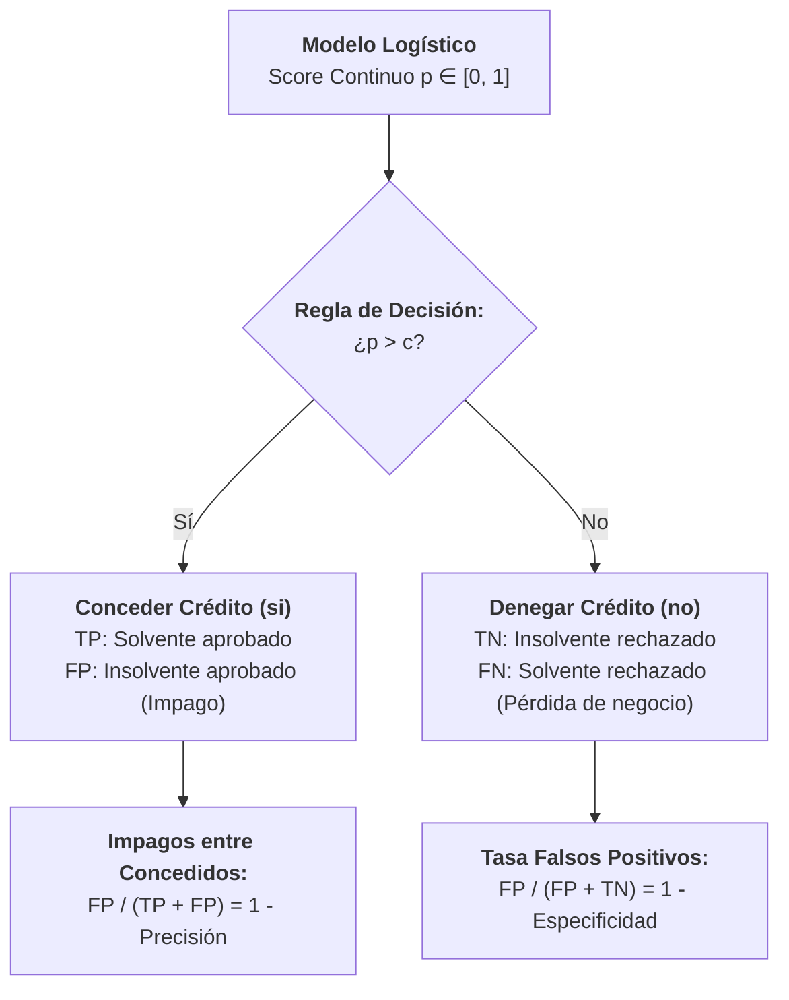
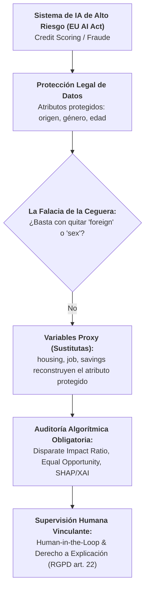

# Sesión 4: Modelos Lineales Generalizados (GLM), Regresión Logística y Clasificación Binaria
## Del Riesgo Crediticio a la Calibración de LLMs, Umbrales Asimétricos y Fair ML (EU AI Act)

> **Materia**: Modelos Lineales Generalizados (GLM), Regresión Logística, Odds Ratios, Calibración y Métricas de Decisión  
> **Programa**: Máster Universitario en Big Data & Data Science (MUBD) — LaSalle Campus Barcelona  
> **Conexión Tecnológica**: Capas de Clasificación Sigmoide / Softmax en Deep Learning, Pérdida de Entropía Cruzada Binaria (BCE Loss), Calibración de Incertidumbre en Modelos de Lenguaje (LLMs / Temperature Scaling), Detección de Fraude Bajo Desbalanceo Masivo, y Equidad Algorítmica conforme al Reglamento Europeo de Inteligencia Artificial (EU AI Act).

---

## 1. Fundamentos Teóricos de la Sesión 4

### 1.1. El Colapso del Modelo Lineal de Probabilidad (LPM)
Al modelar una respuesta binaria dicotómica $Y_i \in \{0, 1\}$ (e.g., $1 = \text{"paga el crédito"}$, $0 = \text{"impago"}$), intentar ajustar una regresión lineal clásica por Mínimos Cuadrados Ordinarios (OLS), conocida como **Modelo Lineal de Probabilidad (LPM)**:
$$P(Y_i = 1 \mid X_i) = E[Y_i \mid X_i] = X_i \beta$$
genera tres contradicciones matemáticas y conceptuales insalvables:

1. **Predicciones Físicamente Imposibles**: La función afín $X_i \beta$ no tiene cotas; para valores extremos de las covariables, produce probabilidades predichas $\hat{p}_i < 0$ o $\hat{p}_i > 1$, carentes de interpretación probabilística.
2. **Heterocedasticidad Estructural Obligatoria**: Dado que $Y_i$ sigue condicionalmente una distribución Bernoulli de parámetro $p_i = X_i \beta$, su varianza condicional es:
   $$\mathrm{Var}(Y_i \mid X_i) = p_i (1 - p_i) = (X_i \beta)(1 - X_i \beta)$$
   La varianza no es constante: depende obligatoriamente de $X_i$ y se anula en los extremos ($p_i \to 0$ o $p_i \to 1$). Se viola el supuesto básico de homocedasticidad de Gauss-Markov, lo que provoca que los errores estándar de OLS sean ineficientes y los contrastes de significación inválidos.
3. **No Normalidad de los Residuos**: Para un valor fijado de $X_i$, el residuo $e_i = Y_i - X_i \beta$ solo puede tomar dos únicos valores discretos: $1 - X_i \beta$ (con probabilidad $p_i$) o $-X_i \beta$ (con probabilidad $1 - p_i$). La distribución de los residuos es bimodal discreta; el supuesto de normalidad queda radicalmente vulnerado.

---

### 1.2. Marco GLM y la Función de Enlace Logit
Los Modelos Lineales Generalizados (Nelder & Wedderburn, 1972) amplían la regresión lineal asumiendo que:
1. La variable respuesta pertenece a la **familia exponencial de distribuciones** (Bernoulli, Poisson, Gamma, Normal).
2. Existe un predictor lineal $\eta = X\beta$.
3. La media condicional $\mu = E[Y \mid X]$ se vincula con el predictor lineal mediante una **función monótona y diferenciable de enlace (*link function*)**:
   $$g(\mu) = \eta = X\beta$$

Para la distribución Bernoulli ($Y \in \{0, 1\}$ con $\mu = p$), la función de enlace canónica es el **Logit** (el logaritmo del cociente de probabilidades u odds):
$$\eta = g(p) = \ln\left( \frac{p}{1 - p} \right) = \beta_0 + \beta_1 X_1 + \dots + \beta_k X_k$$
Invirtiendo la función $g$, se obtiene la **función logística estándar (función sigmoide $\sigma$)**:
$$p(X) = g^{-1}(\eta) = \frac{e^{X\beta}}{1 + e^{X\beta}} = \frac{1}{1 + e^{-X\beta}} = \sigma(X\beta)$$

```
Predictor Lineal (Logit) η:   -∞ ------------------- 0 -------------------> +∞
                               |                     |                      |
Probabilidad Acotada p(X):     0 ------------------ 0.5 ------------------> 1.0
```

*Propiedades Matemáticas de la Función Sigmoide*:
- **Rango Estricto**: Mapea $\mathbb{R} \to (0, 1)$, garantizando que cualquier combinación de predictores resulte en una probabilidad matemáticamente válida.
- **Simetría**: $\sigma(-z) = 1 - \sigma(z)$.
- **Derivada Elegante**:
  $$\frac{d\sigma(z)}{dz} = \sigma(z) \left( 1 - \sigma(z) \right) = p(1 - p)$$

---

### 1.3. Odds y Odds Ratios (OR): Interpretación Rigurosa

#### A. Definición Matemática
- **Odds (Ventaja / Momio)**: Cociente entre la probabilidad de que ocurra el evento frente a la probabilidad de que no ocurra:
  $$\mathrm{Odds} = \frac{p}{1 - p}$$
  Si la probabilidad de pagar un crédito es $p = 0{,}80$, los odds son $\frac{0{,}80}{0{,}20} = 4$ (los "odds son de 4 a 1 a favor de pagar").
- **Odds Ratio (OR)**: Compara los odds de dos observaciones cuyos perfiles difieren en una unidad del predictor $X_j$:
  $$\mathrm{OR}_j = \frac{\mathrm{Odds}(X_j + 1)}{\mathrm{Odds}(X_j)} = \frac{e^{\beta_0 + \dots + \beta_j (X_j + 1)}}{e^{\beta_0 + \dots + \beta_j X_j}} = e^{\beta_j}$$

#### B. Interpretación para Covariables Numéricas y Categóricas
1. **Variables Numéricas Continuas (e.g., Edad `age`)**:
   - Por cada incremento de **un año** de edad, los odds de pagar se multiplican por $e^{\beta_{\text{age}}}$.
   - Para un incremento de **$k$ años** (e.g., $k = 10$ años en el microejercicio de la sesión):
     $$\mathrm{OR}_{k} = e^{k \cdot \beta_{\text{age}}}$$
2. **Variables Categóricas frente al Nivel de Referencia**:
   - Los coeficientes $\beta$ miden la diferencia en escala logit frente a la categoría designada como referencia:
     $$\mathrm{OR}_{\text{categoría}} = e^{\beta_{\text{categoría}}}$$
   - *Caso práctico de la Sesión 4 (`foreign=yes` frente a referencia `foreign=no`)*:
     $$\hat{\beta}_{\text{foreign=yes}} = -1{,}7554 \implies \mathrm{OR} = e^{-1{,}7554} \approx 0{,}173$$
     Los *odds* de amortizar el préstamo en un trabajador extranjero representan un **$17{,}3\%$** de los *odds* de un trabajador nacional (una reducción del **$82{,}7\%$** en los odds de pago), manteniendo constantes todos los demás factores (*ceteris paribus*).
   - *Significación Estadística*: El intervalo de confianza del 95 % por verosimilitud de perfil es $[0{,}0258, 0{,}6705]$. Como **no incluye el valor 1**, el efecto es estadísticamente significativo al nivel $\alpha = 0{,}05$.

> [!IMPORTANT]
> **Diferencia Fundamental entre Cambio en Odds y Cambio en Probabilidad**:
> Un $\mathrm{OR} = 0{,}173$ **NO** significa que la probabilidad de pago se reduzca un $82{,}7\%$ ni que sea $0{,}17$ veces la inicial. La variación de la probabilidad depende de la derivada de la sigmoide:
> $$\frac{\partial p}{\partial X_j} = \beta_j \cdot p(1 - p)$$
> El impacto en probabilidad depende del punto basal de riesgo del cliente: si un individuo partía de $p = 0{,}98$, su probabilidad apenas se reducirá; si partía de $p = 0{,}50$, el descenso en probabilidad será máximo. El efecto multiplicativo constante opera sobre los **odds**, nunca sobre las probabilidades.

---

### 1.4. Estimación por Máxima Verosimilitud (MLE) y Algoritmo IRLS
Dado que los datos observados proceden de variables Bernoulli independientes, la función de verosimilitud es:
$$L(\beta) = \prod_{i=1}^n p_i^{y_i} (1 - p_i)^{1 - y_i}, \quad \text{donde } p_i = \sigma(X_i \beta)$$
Tomando logaritmos neperianos:
$$\ln L(\beta) = \sum_{i=1}^n \left[ y_i \ln(p_i) + (1 - y_i) \ln(1 - p_i) \right] = \sum_{i=1}^n \left[ y_i (X_i \beta) - \ln(1 + e^{X_i \beta}) \right]$$

#### Ausencia de Solución Cerrada y Optimización por Newton-Raphson
La función de log-verosimilitud es estrictamente cóncava (su matriz Hessiana es semidefinida negativa), garantizando un único máximo global. Igualando el vector gradiente a cero:
$$\nabla \ln L(\beta) = X^T (Y - p) = 0$$
No existe despeje algebraico directo. Se resuelve iterativamente mediante **Newton-Raphson**:
$$\beta^{(t+1)} = \beta^{(t)} - \left[ \nabla^2 \ln L(\beta^{(t)}) \right]^{-1} \nabla \ln L(\beta^{(t)})$$
Donde la matriz Hessiana es:
$$\nabla^2 \ln L(\beta) = -X^T W X, \quad \text{con } W = \mathrm{diag}\left( p_i (1 - p_i) \right)$$
Reordenando algebraicamente, el algoritmo toma la forma de **Mínimos Cuadrados Ponderados Iterativos (IRLS: Iteratively Reweighted Least Squares)**:
$$\beta^{(t+1)} = \left( X^T W_t X \right)^{-1} X^T W_t z_t$$
Donde $z_t = X\beta^{(t)} + W_t^{-1}(Y - p_t)$ es la variable de trabajo ajustada.

---

### 1.5. Bondad de Ajuste y Calibración del Modelo
- **Test de Hosmer-Lemeshow**:
  - Ordena a los individuos por su probabilidad predicha $\hat{p}_i$ y los divide en $g$ deciles de riesgo ($g = 10$).
  - Compara las frecuencias observadas ($O_{1k}, O_{0k}$) frente a las esperadas bajo el modelo ($E_{1k} = \sum_{i \in \text{bin}_k} \hat{p}_i$, $E_{0k} = n_k - E_{1k}$):
    $$C = \sum_{k=1}^g \left[ \frac{(O_{1k} - E_{1k})^2}{E_{1k}} + \frac{(O_{0k} - E_{0k})^2}{E_{0k}} \right] \sim \chi^2_{g - 2}$$
  - *Interpretación*: Un p-valor $p > 0{,}05$ indica que no hay discrepancias significativas a nivel global entre las predicciones agregadas y la realidad.
  - *Limitación*: Es un resumen escalar sensible al número arbitrario de bins y puede carecer de potencia para detectar descalibraciones en los extremos.
- **Gráficos de Fiabilidad / Calibración (*Reliability Diagrams*)**:
  Grafican la probabilidad predicha media en cada bin frente a la proporción observada real de pagos. La diagonal ideal de $45^\circ$ representa calibración perfecta. Permite visualizar si el modelo peca de exceso de optimismo o pesimismo en regiones específicas de probabilidad.

---

### 1.6. Del Score Continuo a la Decisión Discreta: Umbrales y Matrices de Coste



#### A. Matriz de Confusión y Métricas de Clasificación
Fijado un umbral de corte $c$ (e.g., $c = 0{,}5$):
- **Sensibilidad (Recall / True Positive Rate - TPR)**: $\frac{\mathrm{TP}}{\mathrm{TP} + \mathrm{FN}}$. Proporción de clientes solventes que son aprobados.
- **Especificidad (True Negative Rate - TNR)**: $\frac{\mathrm{TN}}{\mathrm{TN} + \mathrm{FP}}$. Proporción de clientes insolventes que son bloqueados.
- **Tasa de Falsos Positivos (FPR)**: $1 - \mathrm{Especificidad} = \frac{\mathrm{FP}}{\mathrm{FP} + \mathrm{TN}}$. Proporción de solicitantes insolventes a los que se aprobó crédito erróneamente.
- **Precisión (Positive Predictive Value - PPV)**: $\frac{\mathrm{TP}}{\mathrm{TP} + \mathrm{FP}}$. Proporción de solventes reales dentro de los créditos aprobados.
- **Exactitud (Accuracy)**: $\frac{\mathrm{TP} + \mathrm{TN}}{\mathrm{Total}}$. Porcentaje global de aciertos.

> [!WARNING]
> **Distinción Esencial de Denominadores (Impagos Concedidos vs FPR)**:
> En la evaluación de la Sesión 4 en el conjunto de test ($N = 313$):
> 1. **Impagos entre Concedidos ($1 - \text{Precisión}$)**:
>    $$\frac{\mathrm{FP}}{\mathrm{TP} + \mathrm{FP}} = \frac{43}{194 + 43} = \frac{43}{237} \approx \mathbf{18{,}14\%}$$
>    *Denominador*: Total de operaciones aprobadas por el banco ($237$). Mide la tasa de morosidad esperada en la cartera de préstamos en vigor.
> 2. **Tasa de Falsos Positivos (FPR = $1 - \text{Especificidad}$)**:
>    $$\frac{\mathrm{FP}}{\mathrm{FP} + \mathrm{TN}} = \frac{43}{43 + 43} = \frac{43}{86} = \mathbf{50{,}00\%}$$
>    *Denominador*: Total de individuos insolventes que solicitaron crédito ($86$). Mide la permeabilidad del filtro de scoring ante el fraude o insolvencia.

#### B. Optimización de Umbrales bajo Costes Asimétricos
Fijar $c = 0{,}5$ es una decisión ingenua que asume costes idénticos para ambos errores. En la banca real:
- Coste de un Falso Positivo ($C_{\text{FP}}$): Pérdida total del capital principal prestado (e.g., $10.000$ €).
- Coste de un Falso Negativo ($C_{\text{FN}}$): Margen de intereses dejado de ganar (e.g., $800$ €).
El umbral óptimo que minimiza la pérdida financiera esperada es:
$$c^* = \frac{C_{\text{FP}}}{C_{\text{FP}} + C_{\text{FN}}} = \frac{10.000}{10.000 + 800} \approx 0{,}926$$
Bajo este escenario asimétrico, la entidad solo concederá préstamos a clientes con una probabilidad predicha de solvencia superior al $92{,}6\%$.

#### C. Curva ROC frente a Curva Precision-Recall (PR-AUC)
- **Curva ROC**: Grafica $\mathrm{Sensibilidad}$ (TPR) frente a $\mathrm{FPR}$ para todos los umbrales posibles $c \in [0, 1]$.
  - El **AUC-ROC** cuantifica la capacidad global del modelo para ordenar observaciones según su riesgo.
  - *Interpretación Probabilística*: $\mathrm{AUC} = P(\hat{p}_{\text{positivo}} > \hat{p}_{\text{negativo}})$. Un modelo aleatorio tiene $\mathrm{AUC} = 0{,}50$; el modelo final de la sesión alcanza $\mathrm{AUC} = 0{,}836$ en entrenamiento y $\mathrm{AUC} = 0{,}750$ en test.
- **Curva Precision-Recall**: En problemas con **desbalanceo severo** (e.g., fraude al 0.1%), la curva ROC es engañosamente optimista porque el enorme número de TN mantiene el FPR artificialmente bajo. La curva PR refleja con total transparencia la caída de la precisión sobre la clase minoritaria.

---

## 2. Aplicación Directa a Big Data e Inteligencia Artificial

### 2.1. De la Regresión Logística a la Capa Softmax en Deep Learning
La función de pérdida estándar en Machine Learning para clasificar instancias binarias es la **Binary Cross-Entropy (BCE Loss)**:
$$\mathcal{L}_{\mathrm{BCE}} = -\frac{1}{n} \sum_{i=1}^n \left[ y_i \ln(\hat{p}_i) + (1 - y_i) \ln(1 - \hat{p}_i) \right]$$
Esta función de coste es **exactamente la función de log-verosimilitud negativa de Bernoulli dividida por $n$**. Entrenar una red neuronal para clasificación equivale a maximizar la verosimilitud logística mediante descenso de gradiente.

Para clasificación con $K > 2$ clases mutuamente excluyentes, la regresión logística multinomial se generaliza en la función de activación **Softmax**:
$$\hat{p}_k = \frac{e^{z_k}}{\sum_{j=1}^K e^{z_j}}$$
Y la función de pérdida asociada es la **Categorical Cross-Entropy**. Es la capa final presente en todos los Modelos Fundacionales de Lenguaje (GPT-4, LLaMA, Gemini) y modelos de Visión Artificial.

---

### 2.2. Calibración de Incertidumbre en Redes Neuronales Profundas y LLMs
Un descubrimiento crítico en la IA contemporánea (Guo et al., 2017) demostró que **las redes neuronales modernas (Transformers, ResNets) tienen una alta exactitud predictiva pero están severamente descalibradas**: tienden a asignar probabilidades superiores al 0.99 incluso cuando sus predicciones son incorrectas (sobreconfianza patológica).

#### Métricas y Técnicas de Calibración
1. **Expected Calibration Error (ECE)**: Divide las probabilidades predichas en $M$ intervalos y calcula la diferencia absoluta ponderada entre la precisión observada y la confianza promedio:
   $$\mathrm{ECE} = \sum_{m=1}^M \frac{|B_m|}{N} \left| \mathrm{acc}(B_m) - \mathrm{conf}(B_m) \right|$$
2. **Temperature Scaling (Post-procesamiento de Calibración)**:
   Modifica los logits $z$ antes de la función Softmax mediante un parámetro escalar de temperatura $T > 0$:
   $$\hat{p}_k(T) = \frac{e^{z_k / T}}{\sum_j e^{z_j / T}}$$
   - Si $T > 1$, "enfría" la distribución, suavizando las probabilidades y eliminando la sobreconfianza.
   - **Propiedad Fundamental**: Como la transformación por $T$ es estrictamente monótona, **no modifica el ranking de predicciones ni altera la exactitud (Accuracy) ni el AUC**, pero reduce el ECE a mínimos históricos. Es la técnica estándar empleada para calibrar la incertidumbre en modelos de lenguaje (LLMs) y sistemas de visión médica.

---

### 2.3. Modelos de Credit Scoring y Detección de Fraude en Big Data
En sistemas bancarios que procesan millones de transacciones por segundo en Apache Kafka y Spark Streaming, los impagos o fraudes representan una fracción diminuta ($< 0{,}1\%$). La modelización logística se adapta mediante:
- **Técnicas de Remuestreo y Muestreo Sintético**: SMOTE (*Synthetic Minority Over-sampling Technique*) para equilibrar la frontera de decisión.
- **Pérdida Focal (*Focal Loss*)**:
  $$\mathcal{L}_{\text{Focal}} = -\alpha_t (1 - p_t)^\gamma \ln(p_t)$$
  Reduce el peso de los ejemplos fáciles de clasificar (la inmensa masa de clientes que pagan normalmente), obligando al modelo a concentrar su capacidad de aprendizaje en los perfiles difíciles de riesgo.

---

### 2.4. Equidad Algorítmica (Fairness in ML) y Cumplimiento del Reglamento Europeo de IA (EU AI Act)
Bajo el **Reglamento Europeo de Inteligencia Artificial (EU AI Act)**, los sistemas de IA utilizados para la evaluación de solvencia crediticia y fijación de precios de seguros están formalmente catalogados como **Sistemas de Inteligencia Artificial de Alto Riesgo**.



#### A. La Falacia de la "Ceguera Algorítmica" (*Fairness Through Unawareness*)
El cuaderno de la Sesión 4 incluye variables protegidas como `status.sex` (sexo), `age` (edad) y `foreign` (trabajador extranjero). Retirar formalmente del modelo la variable `foreign` **no garantiza la ausencia de discriminación**, debido a las **variables sustitutas (*proxies*)**: atributos como `housing` (tipo de vivienda), `savings` (nivel de ahorro) o `job` (tipo de trabajo) están correlacionados con el origen, permitiendo al algoritmo reconstruir indirectamente el sesgo discriminatorio.

#### B. Métricas Formales de Equidad en Machine Learning
Sea $A \in \{0, 1\}$ un atributo sensible protegido y $\hat{Y} \in \{0, 1\}$ la decisión del algoritmo:
1. **Paridad Demográfica (*Demographic Parity*)**:
   $$P(\hat{Y} = 1 \mid A = 0) = P(\hat{Y} = 1 \mid A = 1)$$
   Exige que la tasa de concesión sea idéntica entre colectivos.
2. **Igualdad de Oportunidades (*Equal Opportunity* — Hardt et al., 2016)**:
   $$P(\hat{Y} = 1 \mid A = 0, Y = 1) = P(\hat{Y} = 1 \mid A = 1, Y = 1)$$
   Exige que la sensibilidad (TPR) sea igual entre grupos: a los solicitantes solventes de ambos colectivos se les debe aprobar el crédito con la misma tasa.
3. **Paridad Predictiva (*Predictive Parity*)**: Exige igual precisión (PPV) entre grupos.

#### C. El Teorema de Imposibilidad de la Equidad Algorítmica (Kleinberg et al., 2016)
Demuestra matemáticamente que, si las tasas basales de pago entre dos colectivos son distintas ($P(Y=1 \mid A=0) \neq P(Y=1 \mid A=1)$), **es imposible satisfacer simultáneamente la calibración del modelo, la igualdad de falsos positivos y la igualdad de falsos negativos**. La gobernanza de la IA exige explicitar el compromiso ético adoptado.

#### D. Mandatos Legales de Gobernanza (EU AI Act & RGPD)
- **Derecho a la Explicación Individual** (RGPD art. 22): Todo cliente al que se le deniegue un crédito tiene derecho a recibir una explicación comprensible de los factores clave que determinaron la decisión negativa (mediante coeficientes de regresión logística o valores SHAP).
- **Supervisión Humana en el Bucle (*Human-in-the-Loop*)**: Las denegaciones de crédito basadas en IA deben estar sujetas a revisión vinculante por analistas humanos con capacidad para revocar la decisión del modelo.
